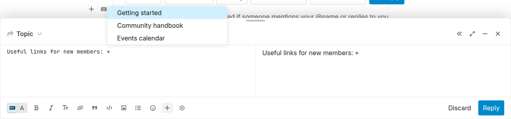
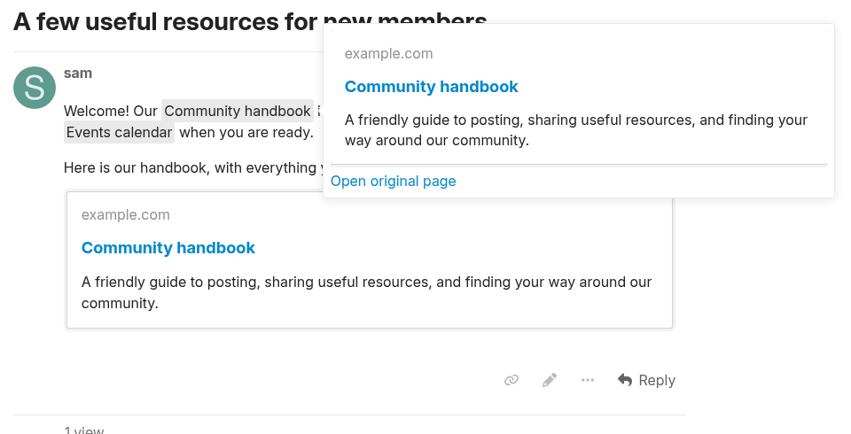
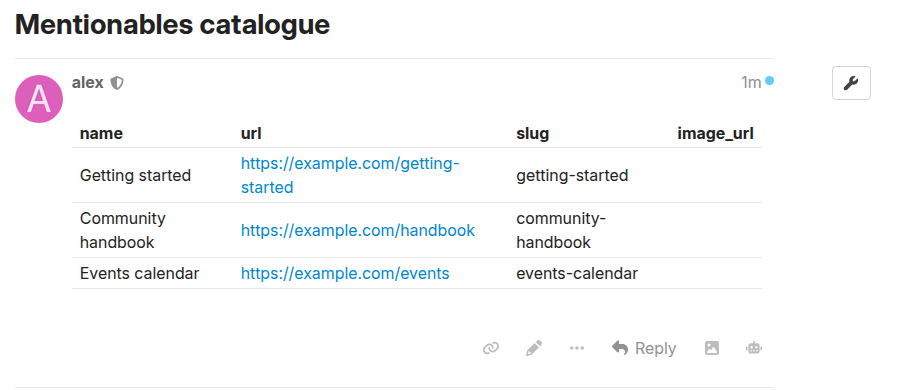
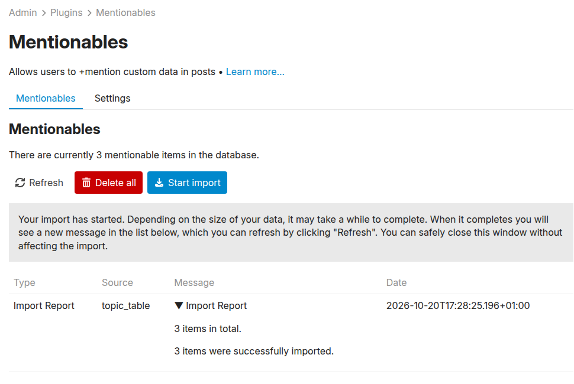

# Discourse Mentionables

|                      |                        |                                                                                                                                                                   |
| -------------------- | ---------------------- | ----------------------------------------------------------------------------------------------------------------------------------------------------------------- |
| :information_source: | **Summary**            | Turn a table in a topic into searchable items that members can mention with `+`, complete with links and onebox previews.                                         |
| :hammer_and_wrench:  | **Repository**         | [Discourse Mentionables](https://github.com/merefield/discourse-mentionables)                                                                                     |
| :open_book:          | **Installation guide** | [Install plugins on a self-hosted Discourse site](https://meta.discourse.org/t/install-plugins-on-a-self-hosted-site/19157)                                       |
| :heart:              | **Sponsorship**        | Please consider [sponsoring ongoing development](https://github.com/sponsors/merefield) to help keep these plugins maintained and working with current Discourse. |

Give your community a shared vocabulary for the things it talks about: books,
products, projects, places, support resources, or anything else with a URL.
Members type `+` and part of a name, choose a suggestion, and get a readable link
without having to remember the address.



### Features

- **Start with URLs alone.** Importer retrieves names and generates slugs; add
  your own names and slugs as optional overrides.
- **Search as you write.** Type `+` or use the composer toolbar button to search
  by name or slug. Works in both the Markdown and rich text composers.
- **Thumbnails in suggestions.** Supply an optional `image_url` to show an image
  beside the name in autocomplete. This is included in the base plugin.
- **Readable inline links.** Mentions appear as compact pills using the item's
  display name, with a stable slug in the post's Markdown.
- **Native oneboxes.** Put a mention on its own line to show a onebox using
  Discourse's existing layouts and supported destinations.
- **Desktop previews.** Hover or focus an inline pill to open a floating preview
  with an **Open original page** link. Ordinary clicks open the destination.
- **A catalogue your admins can edit in Discourse.** Import from a Markdown table
  in a topic's opening post. No Google account or API credentials are needed.
- **A table button for admins.** Insert an empty mentionables table from the
  composer toolbar, then fill in your items.



Onebox appearance depends on the destination and Discourse's normal onebox
support. Unsupported destinations remain links. Fetching floating onebox previews
requires login; guests can still follow the destination link. Mentions in code
are left alone, and mentions in lists and quotes stay inline.

### Basic Mentionables and the Pro extension

Basic Mentionables is the base plugin. Pro is an optional companion plugin
installed **alongside** it; Pro includes the base features through that dependency.

| Feature                                                         | Basic Mentionables |       With Pro extension       |
| --------------------------------------------------------------- | :----------------: | :----------------------------: |
| Import a Markdown table from a topic's opening post             |        Yes         |              Yes               |
| Keep the source topic in a restricted category                  |        Yes         |              Yes               |
| Admin-only composer button to insert a table skeleton           |        Yes         |  Yes, including icon columns   |
| Search with `+` in Markdown and rich text composers             |        Yes         |              Yes               |
| Thumbnail images in autocomplete suggestions                    |        Yes         |              Yes               |
| Inline mention pills and standalone native oneboxes             |        Yes         |              Yes               |
| Floating previews on desktop hover or keyboard focus            |        Yes         | Yes, in the default hover mode |
| Import from Google Sheets using a service account               |         —          |              Yes               |
| Select between topic tables and Google Sheets                   | Topic tables only  |              Yes               |
| Automatic sync every 12 hours                                   |         —          |    Optional, off by default    |
| Import optional icon names and HTML colours                     |         —          |    Yes, from either source     |
| Open floating previews on click or tap, including touch devices |         —          |            Optional            |

Pro's `icon` and `icon_colour` columns add a coloured icon before the mention's
name. For example, use `book` and `#2563eb` for a handbook. With
`mentionables_pro_click_to_preview` enabled, clicking or tapping a pill opens its
preview; the **Open original page** link in the preview takes you to the target.

The Pro plugin extension is available for my **monthly** GitHub sponsors.
[Sponsor me here](https://github.com/sponsors/merefield) to gain access to Pro :heart:

### Quick setup

1. Install the base plugin using the installation guide above. Rebuild Discourse
   after installation.
2. Create a topic for your catalogue. As an admin, use **Insert mentionables
   table** in the composer toolbar or paste this table into the opening post:

   ```markdown
   | name               | url                                 | slug               | image_url |
   | ------------------ | ----------------------------------- | ------------------ | --------- |
   | Getting started    | https://example.com/getting-started | getting-started    |           |
   | Community handbook | https://example.com/handbook        | community-handbook |           |
   | Events calendar    | https://example.com/events          | events-calendar    |           |
   ```

3. Replace the example URLs with your own, save the post, and set
   `mentionables_topic_id` to that topic's numeric ID. Keep `mentionables_enabled`
   enabled. Pro installations should select `topic_table` in `mentionables_source`
   for this setup.
4. Open **Admin → Plugins → Mentionables**, click **Start import**, then
   **Refresh** to inspect the report. The background job worker must be running.
5. Reload your browser, open a composer, and type `+` to try your items.



Use lowercase column names. **Only `url` is required**, beginning with `http://`
or `https://`. URL-only rows retrieve a name from the destination and generate
a slug. You can supply `name`, `slug`, or both to override those defaults, mixing
these options within one table. If no title is available, the URL becomes the
display name. Existing URLs retain their slugs when the source omits them.
`image_url` and `description` are optional.

For example, give **International Space Station** the slug `iss`: typing `+iss`
finds it, as does searching by its full name.

The importer reads the first unquoted table with a `url` column in the opening
post. Replies, quoted tables, and fenced code samples are ignored. Source topics
must be regular, undeleted topics, rather than personal messages.

### Source privacy and updating your catalogue

You can keep the source topic in Staff or another restricted category so only
trusted people can maintain it. **The imported names, URLs, and images are
available to users of mentionables.** Restricting the topic does not make the
imported catalogue private. Keep confidential information out of the table.

Each import synchronizes by URL: matching URLs update, new URLs create records,
and URLs removed from the source delete records. The complete source must be
valid; duplicate URLs or slugs, invalid rows, failures fetching the source, and
empty datasets leave the catalogue unchanged. Use **Delete all** for an
intentional clear.
Source topics and spreadsheets are never modified. Pro's optional
`mentionables_pro_sync_enabled` setting runs the same import every 12 hours.
Reload the browser after importing. Existing cooked posts are not automatically
rebaked, and explicitly changing a slug can break earlier `+slug` references.



### Settings and further information

| Setting                           | Purpose                                                                            |
| --------------------------------- | ---------------------------------------------------------------------------------- |
| `mentionables_enabled`            | Enable or disable Mentionables.                                                    |
| `mentionables_topic_id`           | Topic containing the source table in its opening post.                             |
| `mentionables_autocomplete_limit` | Maximum number of suggestions; defaults to five.                                   |
| `mentionables_onebox_fallback`    | Also retrieve missing images/descriptions when a name is supplied; off by default. |

See the [README](README.md) for the full setup guide, import behaviour, and
troubleshooting. The screenshots use sample data from the plugin's test fixtures.
